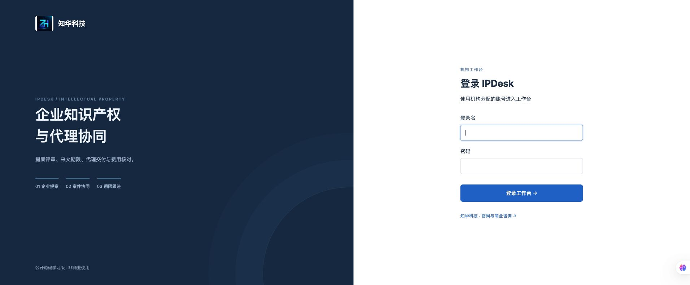
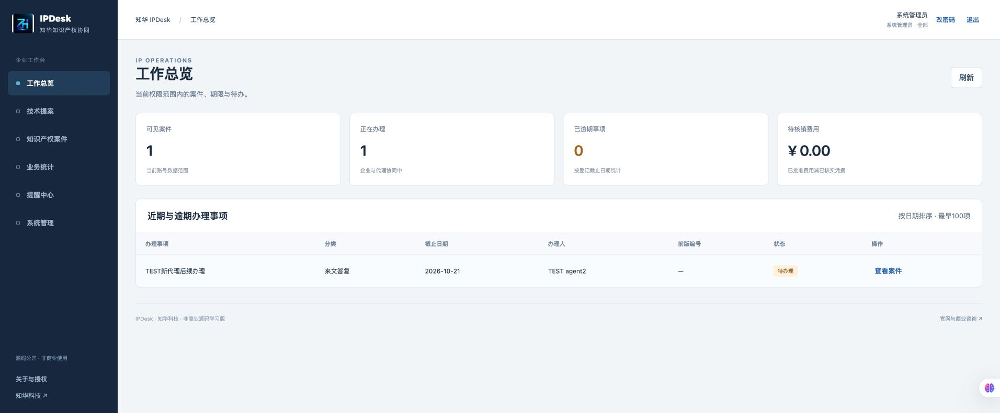
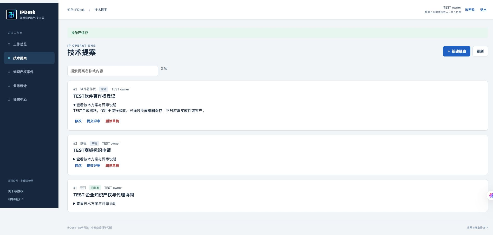
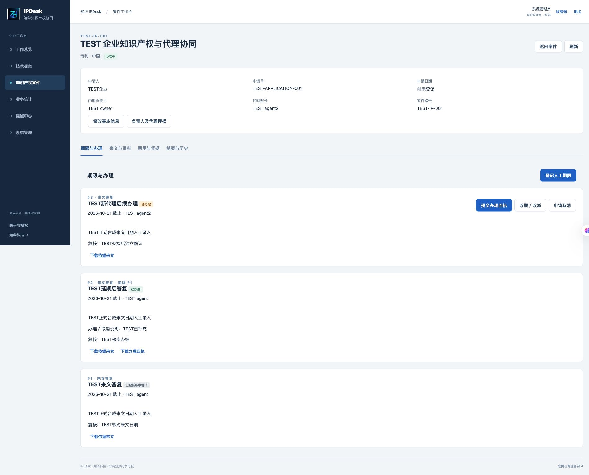
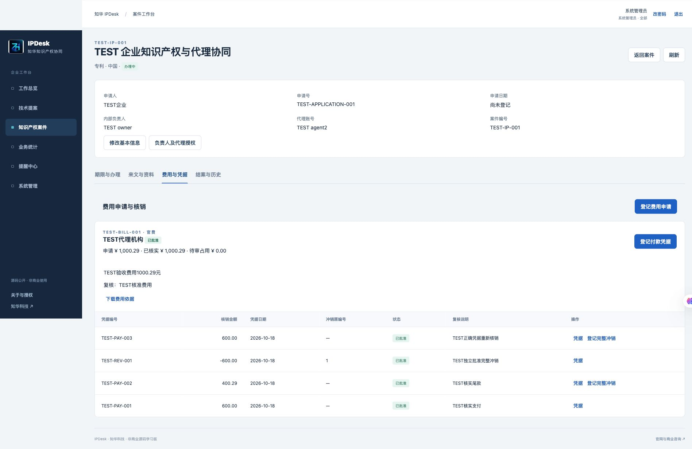
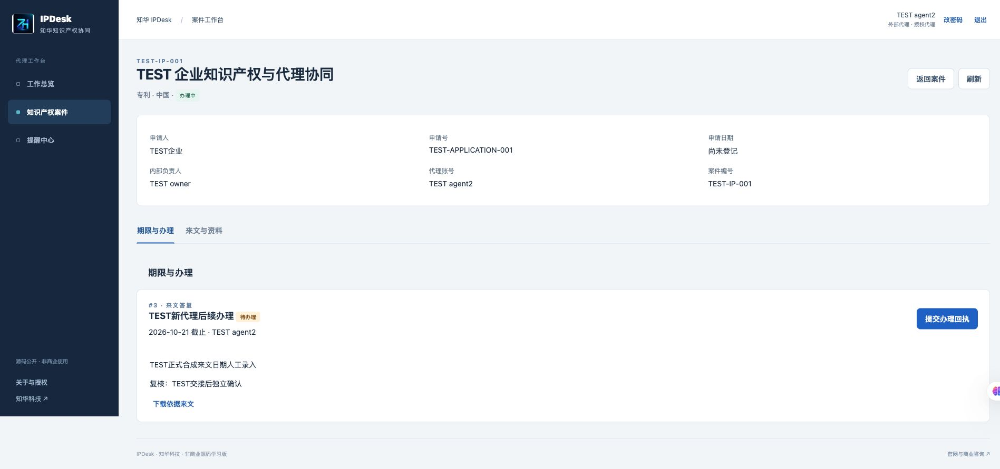
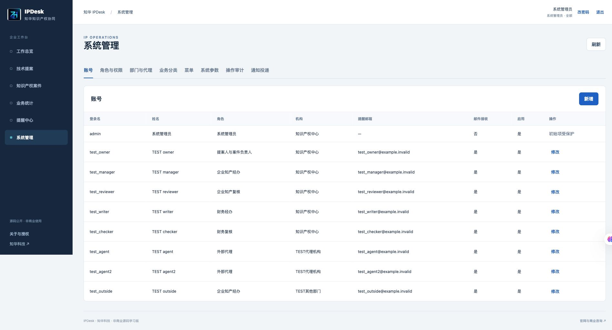
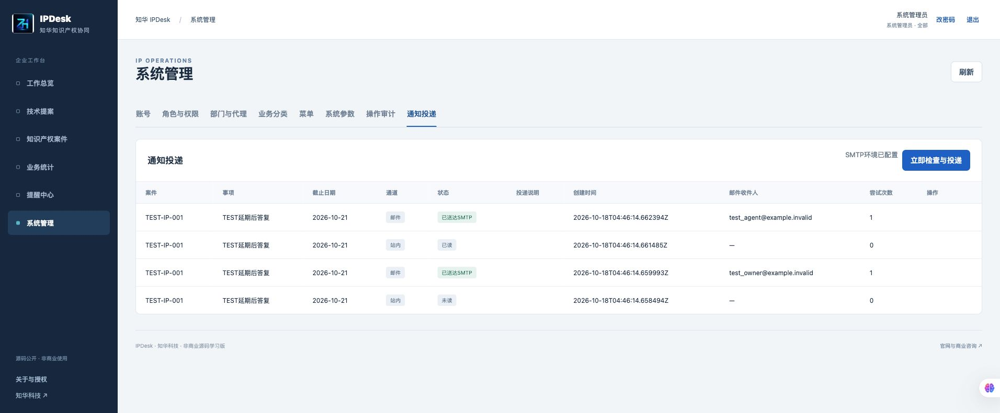
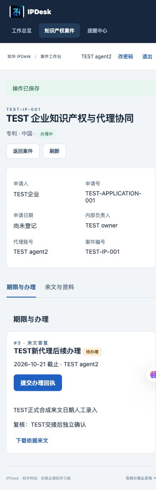

[中文](README.md) | [English](README.en.md)

# ZhiHua IPDesk · Corporate Intellectual Property and Agency Coordination

**ZhiHua Technology (Shanghai Rujing Zhihua Information Technology Co., Ltd.)** · [Official website](https://www.zhuatech.cn/)

A Java 21, Spring Boot, Vue 3 and MySQL workspace for patent, trademark and copyright proposals, corporate case coordination, assigned external agents, manually reviewed deadlines, fee evidence and configurable notifications.

**Source-available learning edition for noncommercial use.** Personal learning and exchange only. Commercial use requires authorization from Shanghai Rujing Zhihua Information Technology Co., Ltd. See [LICENSE](LICENSE); the proprietary source is not licensed under MIT or Apache. Third-party components retain their own terms in [NOTICE](NOTICE).

## Use cases and implemented features

- **Proposers:** draft, submit, withdraw and revise patent, trademark or copyright proposals; view independent reviews.
- **Corporate case teams:** create one case from an approved proposal, maintain applicant and jurisdiction details, assign an internal owner and an external agent, search and paginate cases, request independently reviewed closure or reopening.
- **Deadline coordination:** source document required; manual entry, independent confirmation, replacement versions, completion evidence, acceptance/return and cancellation review. The previous approved deadline remains active until a replacement is approved.
- **External agents:** access only currently assigned cases, shared documents and their own confirmed tasks; upload deliverables. Reassignment immediately revokes the former agent's access, including existing sessions and downloads.
- **Finance:** independently approve fees, record evidence of payments made outside this system, reserve pending amounts, register full reversals and reconcile balances. Amounts are integer cents; the browser uses BigInt.
- **Notifications:** in-app reminders and manual read status; optional SMTP with per-account opt-in, configurable lead time, deduplication, durable delivery status and manually confirmed retry.
- **Administration:** accounts, roles, departments, deadline/fee dictionaries, menus, parameters, audit and delivery records. Administrators cannot approve their own submissions.
- **Files and reporting:** validated PDF/PNG/JPEG originals, immutable versions, SHA-256 and scoped downloads; scoped overview and CSV export. Case access alone does not grant access to finance.

This is one institution per deployment with department and case scopes, rather than a complete multi-tenant SaaS. Fresh initialization creates no sample business cases or shared demo password. Detailed Chinese manuals: [Operations](docs/操作手册.md), [Architecture and security](docs/架构与安全.md), [API](docs/API.md), [Deployment and recovery](docs/部署与恢复.md), [Verification](docs/验证记录.md).

## Actual running screenshots

Captured from this version in an isolated test database using fictional accounts and cases. No real client records are included.

### Institution login



### Corporate overview



### Proposer workspace



### Case deadlines



### Financial evidence



### External agent



### Administration and notifications





### Mobile layout



## Architecture and repository

Vue 3 browser → Nginx same-origin proxy → Spring Boot 4 / Spring Security session and CSRF → JPA / Flyway → MySQL 8.4. Original file bytes and metadata share the database for consistent backup. SMTP claims and outcomes are persisted in separate transactions around the actual network send. Business writes serialize on a database guard row, suitable for a small single-institution instance.

```text
backend/                    Java service, authorization and workflows
  src/main/resources/db/migration/  Versioned Flyway schema
  src/test/                 Rules, real migration and HTTP security tests
frontend/                   Vue application and money precision tests
  public/brand/             Official logo
scripts/                    Initialization, verification, backup and empty-target restore
compose.yaml                MySQL, backend and frontend
compose.storage.yaml        Explicit database directory option
.github/workflows/          Hosted quality checks
docs/                       Images and operations, architecture, API and deployment manuals
```

## Requirements

Recommended: Docker Engine/Desktop with Compose v2, at least 4 GB available RAM and 10 GB storage; initial builds need access to Maven Central, npm and container registries. Compose uses MySQL 8.4.

For native development: JDK 21, Maven 3.9.16 or compatible 3.9.x, Node.js 24.19.0, npm 11 and Python 3.10+. The built frontend does not require a Node server; Python is for helper scripts. Backend tests use H2 in MySQL mode with real Flyway migrations; release verification additionally runs actual MySQL.

## Installation, startup and database initialization

```bash
git clone https://github.com/zhuatech-han/zhuatech-ipdesk.git
cd zhuatech-ipdesk
python3 scripts/init-env.py
docker compose -p ipdesk config --quiet
docker compose -p ipdesk up --build -d --wait --wait-timeout 900
```

Open <http://127.0.0.1:8176/>. Default administrator name: `admin`. Read the generated `ADMIN_PASSWORD` from your private `.env`; never publish it. The initialization script creates independent random passwords, sets mode 600 and refuses to overwrite an existing configuration. Flyway creates the schema on first startup, then bootstrap inserts the administrator, seven roles, menus, dictionaries and parameters. Existing accounts are not reset on restart; changing the initial administrator environment password does not change an existing account's password.

Only the frontend is bound to loopback. Do not delete an existing database volume to resolve startup errors. Back up before upgrades or recovery.

For separate native development, start MySQL with `docker compose -p ipdesk up -d --wait mysql`, securely set `DATABASE_URL`, `DATABASE_USER`, `DATABASE_PASSWORD` and `ADMIN_PASSWORD` in the backend process environment, then run `mvn -f backend/pom.xml spring-boot:run`. In `frontend`, run `npm ci` then `npm run dev`; Vite proxies to backend port 8080. Compose does not expose MySQL by default: native development needs an explicitly configured loopback-only test mapping or another reachable test database. Native Maven does not automatically load `.env`.

## Configuration

[.env.example](.env.example) lists all supported names.

| Variable | Meaning |
| --- | --- |
| `DATABASE_PASSWORD`, `MYSQL_ROOT_PASSWORD` | Generated database credentials; changing them alone does not rotate an initialized volume |
| `ADMIN_USERNAME`, `ADMIN_PASSWORD` | First empty-database bootstrap only |
| `WEB_PORT`, `BIND_ADDRESS` | Defaults: 8176, 127.0.0.1 |
| `DATABASE_URL`, `DATABASE_USER` | Optional external MySQL; default TLS REQUIRED encrypts without CA identity validation; configure CA and VERIFY_IDENTITY for production |
| `COOKIE_SECURE` | Set true behind HTTPS |
| `SCHEDULER_ENABLED` | Defaults true; scans every 60 seconds; tests can disable it and trigger manually |
| `MAIL_ENABLED` | Defaults false; allows actual server-side SMTP sending |
| `MAIL_HOST`, `MAIL_PORT` | SMTP host and port; default port 587 |
| `MAIL_USERNAME`, `MAIL_PASSWORD`, `MAIL_FROM` | Private server-side SMTP settings; management API does not return these secrets |
| `MAIL_TLS` | Defaults true with required STARTTLS; implicit SMTPS port 465 is not supported |

Email requires server SMTP configuration, `MAIL_ENABLED=true`, administration parameter `email_enabled=true`, the overall `reminders_enabled` switch, and an account with a valid email address and explicit opt-in. `warning_days` defaults to 30 (1–180); `max_case_mb` defaults to 40 (10–100).

Unconfigured delivery is marked SKIPPED. SENT means SMTP acceptance, not inbox delivery. Ambiguous sends become UNKNOWN and are not automatically retried; an administrator must check delivery and confirm non-delivery before retry, up to three attempts. In-app read status is a separate manual action. SMTP capture verification used a local Mailpit service and fictional addresses, not actual external inboxes.

## Tests and builds

```bash
mvn -B -f backend/pom.xml spotless:check clean verify
cd frontend
npm ci --no-audit --no-fund
npm run format:check
npm run lint
npm test
npm run build
cd ..
python3 -m pip install -r scripts/requirements-quality.txt
python3 -m black --check scripts
python3 -m py_compile scripts/*.py
python3 -m unittest discover -s scripts -p 'test_*.py'
python3 scripts/release-check.py
git diff --check
```

Use a **new isolated database**, never a business instance, for the writing HTTP test:

```bash
SCHEDULER_ENABLED=false docker compose -p ipdesk-test up --build -d --wait --wait-timeout 900
python3 scripts/smoke.py --env-file .env --private-state /tmp/ipdesk-test-state.json
docker compose -p ipdesk-test down -v --remove-orphans
```

The private state path must be a new file outside the repository; it contains fictional test credentials and is created with mode 600. Default smoke verification checks explicit SMTP skipping without a server. `--mailpit-url` additionally checks an isolated local SMTP capture service; see the verification manual. Docker backend builds execute tests without skipping them.

## Deployment and recovery

Before real deployment, obtain commercial authorization, configure HTTPS and Secure cookies, establish credential rotation, restricted access, backups and recovery exercises, and assess security and capacity. Reverse proxy the loopback frontend; keep MySQL and backend container ports private. Use verified MySQL TLS identity and controlled SMTP. No production readiness or SLA is claimed.

```bash
python3 scripts/backup.py --env-file .env --project ipdesk --output /absolute/private/ipdesk-backup.sql
```

Backups include original file bytes and must be outside source control, mode 600, encrypted and access-controlled in storage. Output must not already exist. To rehearse recovery, prepare a separate private environment with a different port and independent database, then:

```bash
docker compose --env-file /absolute/private/restore.env -p ipdesk-restore-check up -d --wait --wait-timeout 900 mysql
python3 scripts/restore.py --env-file /absolute/private/restore.env --project ipdesk-restore-check --input /absolute/private/ipdesk-backup.sql
docker compose --env-file /absolute/private/restore.env -p ipdesk-restore-check up --build -d --wait --wait-timeout 900
```

Only an empty `ipdesk-restore-*` target is accepted; existing tables cause rejection. Restored accounts retain their original passwords. Verify health, login, case states, deadlines, exact financial balances, audit and file SHA-256. Remove only the isolated rehearsal instance afterwards. The optional `compose.storage.yaml` requires an explicit, existing dedicated directory via `MYSQL_DATA_DIR`; it does not migrate an existing volume.

## Known limitations

- No patent/trademark/copyright authority integration, official status synchronization, legal deadline calculation, patent search or AI legal judgment. Human-entered deadlines and reviews still require professional checking.
- No fund transfer, invoice issuance or bank reconciliation integration. Only evidence of external payments is recorded; RMB with two decimals, full original-payment reversals only.
- No SMS, WeChat, mobile push or inbox delivery/read receipt service; SMTP acceptance is the available mail signal.
- One institution per instance; serialized writes, lists capped at 10,000 records and up to 100 deadlines in the overview. Large-scale database paging, aggregation and load work remain deployment-specific.
- PDF/PNG/JPEG only, 3 MiB per file, 100 versions per case and configurable total capacity. No Office/archive support, malware scanning or full-text indexing. A shared version cannot be unshared; handle mistaken sharing through institutional procedures. Reassigning the agent revokes the former agent's access immediately.
- No SSO/MFA, penetration test, production load certification or guarantee of completeness across jurisdictions and legal procedures.

## Licensing and contact

The proprietary source is available only for personal learning and exchange, for noncommercial use. Commercial use requires authorization from Shanghai Rujing Zhihua Information Technology Co., Ltd. [LICENSE](LICENSE) governs the exact scope; [NOTICE](NOTICE) preserves third-party terms.

For commercial licensing, custom development, deployment and systems integration, contact ZhiHua Technology:

- Website: [https://www.zhuatech.cn/](https://www.zhuatech.cn/)
- Email: [han@zhuatech.cn](mailto:han@zhuatech.cn)
- Email: [jack@zhuatech.cn](mailto:jack@zhuatech.cn)
- WhatsApp: [+86 17521234993](https://wa.me/8617521234993)
